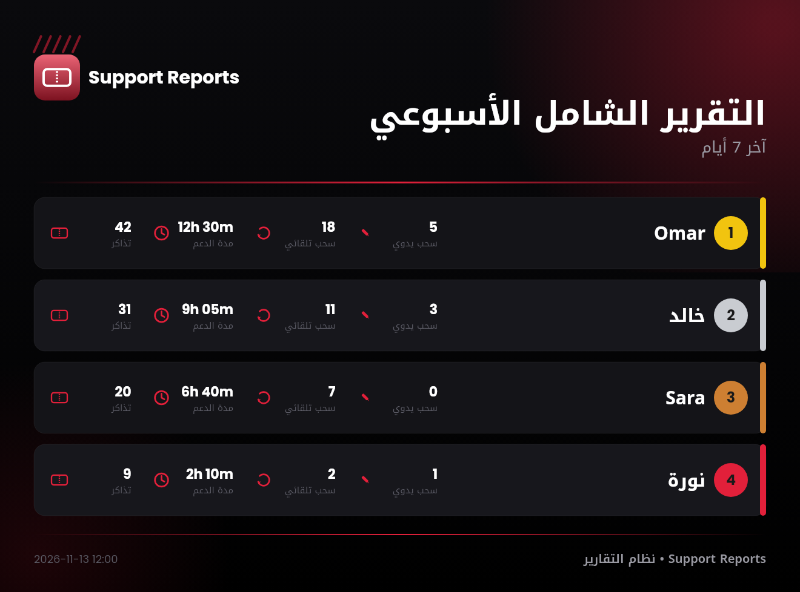

# 🎫 Ticket Report Bot

A Discord bot that **automates support-team activity reports** for FiveM roleplay servers. Any server can use it — just fill in its own channel IDs, roles, logo, and colors.

It reads the server's existing log channels (Wick tickets, Ticket Tool, and voice logs) and turns them into weekly and monthly reports — on command, or automatically every Friday. No database: everything is parsed live from the channel history.

---

## Reports

All reports live under one command: `/تقرير <type>`, each with a **weekly** or **monthly** period.

| Command | What it reports | Source |
|---|---|---|
| `/تقرير تذاكر` | Tickets closed per staff member | Wick ticket log |
| `/تقرير تذاكر-ثانوية` | Tickets closed in secondary departments | Ticket Tool log |
| `/تقرير سحب-يدوي` | Manual pulls logged by each staff member | Manual pull log |
| `/تقرير حضور` | Time spent in support voice rooms + automatic pulls | Voice activity log |
| `/تقرير شامل` | Everything above in one report, **rendered as an image** | All logs |
| `/تقييم` | Adds a handling note and a 1–5 rating to a row in the ticket report, and can correct a ticket count by hand | — |
| `/تشخيص-تذاكر` | Diagnostic: prints the raw format of recent Ticket Tool log messages to the console | Ticket Tool log |

### Example — full report image

<p align="center"></p>

<p align="center"><i>Sample data. The name, color, and logo come from your server's settings.</i></p>

## Automation

- **Weekly auto report** — the full image report is posted every Friday at a set hour (Riyadh time).
- **Image reports** — the full report is drawn as a styled image (rankings, icons, Arabic and English text) using `@napi-rs/canvas`.
- **Role filter** — only members with a support role are counted.
- **Accurate pull counting** — an automatic pull only counts when a staff member moves someone from the waiting room into a support room.
- **Noise filter** — ignore specific users or bots that flood the voice log (`IGNORED_USER_IDS`).
- **Mixed date formats** — parses Discord timestamps, Gregorian dates, and Hijri dates in Arabic (e.g. `15 صفر 1448 11:15 م`).
- **Stylized names** — normalizes decorated Unicode room names (like `𝐒𝐮𝐩𝐩𝐨𝐫𝐭`) before matching.
- **Long scans** — large monthly reports reply immediately and post the result when ready, avoiding Discord's interaction timeout. If the voice log is too large to read fully, the report is marked as partial.

## Live support tools (optional)

- **Waiting-room alerts** — when a member joins the waiting room, staff get an alert with a dropdown (Support 1–10) to pull them in one click. The bot records who pulled them, lets staff log the reason and resolution in the same message, and flags members who left before being helped.
- **Auto-return** — members left in a support room without staff are moved back to the waiting room after a set time. The alert shows which staff member pulled them in.
- **On-duty game check** — staff playing a non-allowed game while in a support room are moved to the least crowded break room (or disconnected if no break rooms are set), with an alert to the team.

---

## Make it yours

The image report uses your server's identity. Set these in `.env`:

| Variable | What it does | Example |
|---|---|---|
| `BRAND_NAME` | Server name shown at the top and bottom of the report | `My RP City` |
| `BRAND_COLOR` | Main accent color (hex) | `#3b82f6` |
| `BRAND_LOGO` | Path to your logo, relative to the bot folder | `assets/logo/my-logo.png` |

Leave `BRAND_LOGO` empty and the report shows a default ticket icon in your brand color.

## Permissions

All commands are **admin-only by default** (members with the *Manage Server* permission).
To give access to another role, go to **Server Settings → Integrations →** the bot, and allow that role.

## Requirements

The bot reads the log messages of these bots, so your server needs them:
- **Wick** (Arabic language) — ticket log and voice activity log
- **Ticket Tool** — for secondary-department tickets (optional)

## Setup

```bash
npm install
cp .env.example .env      # fill in your token and channel/role IDs
npm run deploy-commands   # register the slash commands (once, or after changes)
npm start
```

Enable these **privileged gateway intents** in the Discord Developer Portal:
Server Members, Message Content, and Presence (only if the game check is on).

## Tech
- Node.js
- discord.js v14
- @napi-rs/canvas (image reports)
- moment-hijri (Hijri dates)

> Never commit your `.env` file — it contains the bot token.
